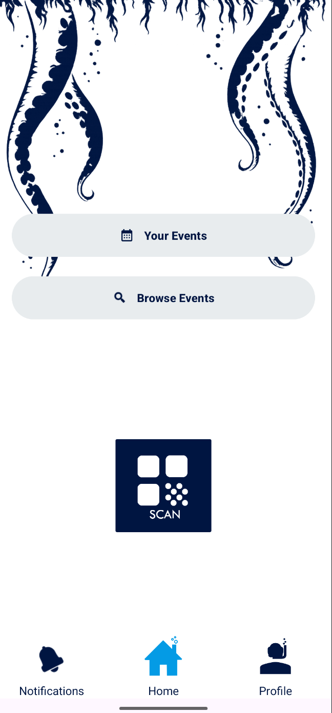
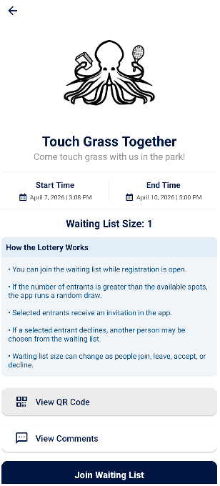
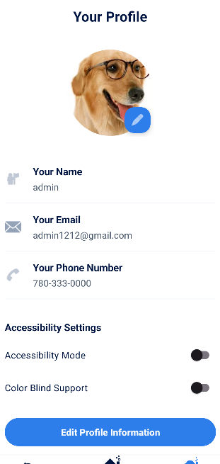
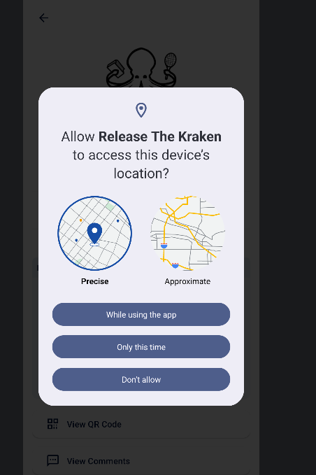

# Release the Kraken

An Android app that runs event sign-ups through a lottery. Organizers create events, entrants join a waiting list, and when registration closes the app randomly draws who gets a spot. Selected entrants accept or decline their invitation in the app, and any declined spot goes to the next person drawn from the list.

I built this with a team of six in a university software engineering course. The app is written in Java in Android Studio, and Firebase handles the backend: the database, image storage, sign-in, and push notifications.

<table align="center">
  <tr>
    <td align="center"><br><b>Home</b></td>
    <td align="center"><br><b>Event details</b></td>
    <td align="center"><br><b>Profile</b></td>
    <td align="center"><br><b>Location prompt</b></td>
  </tr>
</table>

## Features

**Entrants**
- Browse and filter events by keyword, availability, and capacity
- Join or leave an event's waiting list
- Scan an event's QR code to open it directly
- Receive in-app notifications when selected or not selected, and accept or decline invitations
- Comment on events

**Organizers**
- Create and edit events with posters, registration windows, and capacity
- Run the lottery draw and redraw replacements when entrants decline
- Require entrants to share their location to join, and view where entrants joined from on a map
- Make events private, invite users, and add co-organizers

**Administrators**
- Browse and remove events, profiles, images, and organizers
- Remove comments that break app policy
- Review a log of every notification the app has sent
- Act as an organizer or entrant from the same admin account

**Accessibility**
- Larger text and touch targets, plus a color-blind palette

## Built With

**Gradle plugins**
- **Android Application plugin:** builds and packages the app
- **Google Services plugin:** links the app to Firebase, which runs the backend and stores all of the app's data, including events, profiles, and images.

**Libraries**

| Area | Library | What it does in the app |
|------|---------|-------------------------|
| Database | Firebase Firestore | Stores events, profiles, waiting lists, comments, and notifications |
| File storage | Firebase Storage | Holds event posters and profile pictures |
| Sign-in | Firebase Authentication | Handles account creation and login |
| Notifications | Firebase Cloud Messaging | Delivers lottery results and invitations |
| Location | Google Play Services Location | Reads the entrant's location when they join a waiting list |
| Maps | Google Maps SDK | Shows organizers where entrants joined from |
| Camera | CameraX | Runs the live camera preview for the QR scanner |
| QR scanning | ML Kit Barcode Scanning | Detects and reads QR codes from the camera feed |
| QR generation | ZXing | Creates a QR code for each event |
| Images | Glide | Loads and caches posters and profile pictures |
| Scheduling | WorkManager | Runs the lottery draw automatically when registration ends |
| Navigation | Android Navigation | Moves between the app's screens |
| Testing | JUnit | Unit tests for the lottery and waiting list logic |

### Why there is one Kotlin file
The app is written in Java except for `MyFirebaseMessagingService.kt`. Android lets Java and Kotlin share one project, and Firebase's official examples for the messaging service are written in Kotlin, so that class followed them. It listens for new notification tokens and incoming messages from Firebase Cloud Messaging.

## Geolocation

Organizers decide per event whether entrants must share their location to join.

- **When the requirement is on,** the app asks for location permission, reads the device's location through Google Play Services, and saves the coordinates with the entrant's waiting list entry in Firestore.
- **When it's off,** entrants join without sharing any location data.
- **The entrant map** plots each entrant's join location on Google Maps and zooms to fit every marker, so organizers can see where interest in their event is coming from.

## QR Code Scanner

Every event gets its own QR code, which organizers can display or print.

- **Generating:** ZXing turns the event's ID into a QR code image.
- **Scanning:** the scanner screen opens a live camera preview with CameraX, and ML Kit checks each frame for a QR code. When it finds one, the app opens that event's details page, where the entrant can join the waiting list.

## My Contributions

I owned three areas of the app: the Firebase backend setup, geolocation, and the administrator features.

**Firebase setup**
- Created and configured the Firebase project: Firestore for app data, Storage for images, and Cloud Messaging for notifications
- Connected the Android app to Firebase and set up the initial database structure

**Device-based identity**
- Built the first sign-in system, which identified entrants by device so they could use the app without a username or password, and kept their profile across sessions

**Geolocation**
- Added an organizer setting that turns the location requirement on or off for each event
- Captured an entrant's location when they join a waiting list, and skipped it when the event doesn't require it
- Built the entrant map, which plots where each entrant joined from and zooms to fit all markers

**Administrator controls**
- Built the admin screens for browsing and removing events, profiles, images, and organizers
- Built comment moderation, so admins can view and delete comments across every event
- Built the notification log, so admins can review every notification the app sent
- Added role flexibility, so an admin can also create events or join waiting lists without a second account

**Working as a team**

This was my first time building an app with a team over a full term. We met weekly to split up tickets, report progress, and plan the next sprint, and we tracked everything on a shared GitHub project board. I learned to:
- Explain my work clearly so teammates could build on it, especially the Firebase setup that every other feature depended on
- Coordinate through branches and pull requests, and resolve merge conflicts when our changes overlapped
- Plan my tickets around team deadlines so each project checkpoint shipped on time

## Project Structure

```
app/src/main/java/com/example/releasethekraken/
├── controller/   Business logic (waiting lists, lottery, notifications, filtering)
├── model/        Data classes and Firestore repositories
├── repository/   Profile storage
├── util/         Location, QR code, and accessibility helpers
└── view/         Fragments and adapters for each screen
```

## Running Locally

1. Clone the repository and open it in Android Studio.
2. Add your own `google-services.json` from a Firebase project to the `app/` folder.
3. Add a Google Maps API key to `AndroidManifest.xml`.
4. Run on an emulator with Google Play services, or on a physical device. The QR scanner and location features work best on a physical device.
